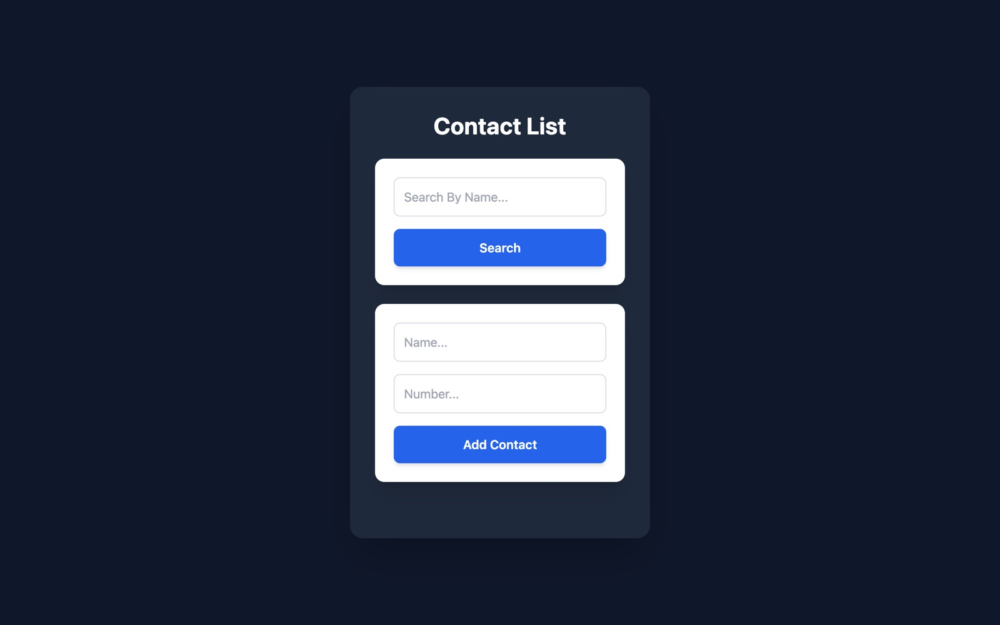

<div align="center">

# 📒 Contact List

A React contact list where you can add contacts and search them by name.

<a href="https://miladmo68.github.io/Contact-List/"></a>
<a href="https://github.com/miladmo68/Contact-List"></a>
<a href="https://miladweb.com"></a>

**🔗 Live:** [miladmo68.github.io/Contact-List](https://miladmo68.github.io/Contact-List/)

</div>

<p align="center">
  
</p>

## ✨ Features

- Add contacts with name and number
- Search contacts by name
- Component-based structure

## 🛠️ Tech Stack

    

## 🚀 Getting Started

**Prerequisites:** [Node.js](https://nodejs.org/) 18 or newer

**Install and run**

```bash
git clone https://github.com/miladmo68/Contact-List.git
cd Contact-List
npm install
npm run dev
```

## 📁 Project Structure

```
Contact-List/
├── public/
├── src/
├── eslint.config.js
├── index.html
├── package.json
├── postcss.config.js
├── tailwind.config.js
└── vite.config.js
```

## 👤 Author

**Milad Mohammadi** — Frontend-Focused Full-Stack Developer, Toronto 🇨🇦

[](https://miladweb.com)
[](https://www.linkedin.com/in/miladmo68/)
[](https://github.com/miladmo68)

<p align="center"><sub>If you like this project, consider giving it a ⭐</sub></p>
